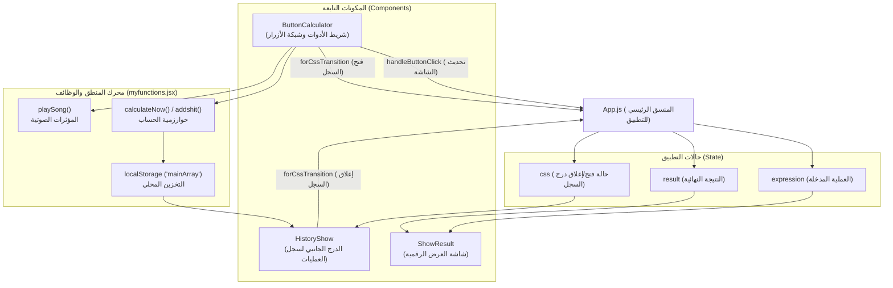
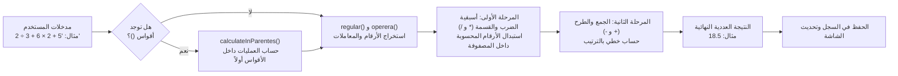
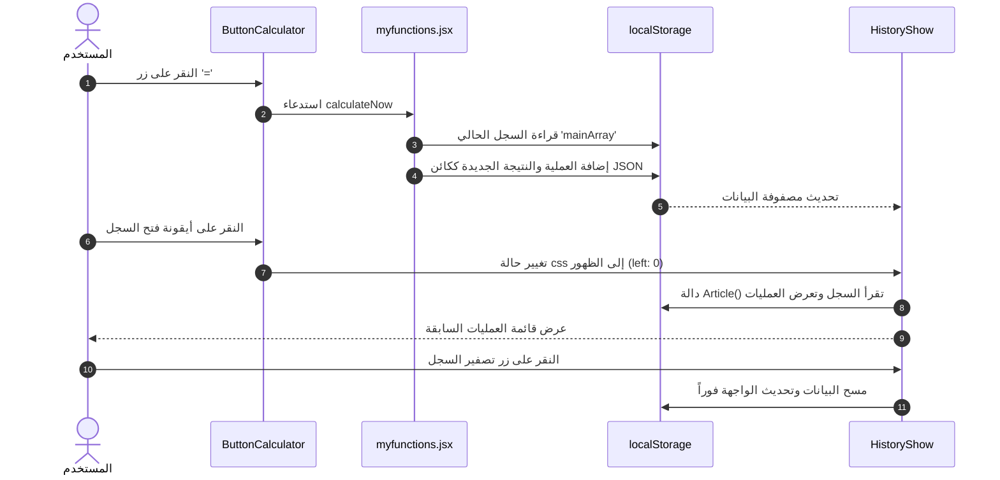

<div align="center">

# 🧮 آلة حاسبة تفاعلية حديثة مع سجل عمليات متقدم
### Modern React Calculator & History Drawer

**آلة حاسبة عصرية ومتقدمة بواجهة داكنة مدمجة مبنية باستخدام React 19، تتميز بمحرك حسابي مخصص لاحترام أسبقية العمليات الرياضية، ومؤثرات صوتية تفاعلية، وسجل دائم لحفظ العمليات.**

[](https://react.dev/)
[](https://developer.mozilla.org/en-US/docs/Web/CSS)
[](https://developer.mozilla.org/en-US/docs/Web/JavaScript)
[](LICENSE)

[🌐 **Read Documentation in English (قراءة التوثيق باللغة الإنجليزية)**](./README.md)

</div>

---

## 📑 فهرس المحتويات

- [نظرة عامة على المشروع](#نظرة-عامة-على-المشروع)
- [المخطط البصري للواجهة (UI Layout)](#المخطط-البصري-للواجهة-ui-layout)
- [المميزات الرئيسية](#المميزات-الرئيسية)
- [معمارية المشروع وتدفق البيانات](#معمارية-المشروع-وتدفق-البيانات)
- [خوارزمية الحساب وأولويات العمليات الرياضية](#خوارزمية-الحساب-وأولويات-العمليات-الرياضية)
- [دورة حياة السجل وحفظ البيانات (LocalStorage)](#دورة-حياة-السجل-وحفظ-البيانات-localstorage)
- [هيكل المجلدات والملفات](#هيكل-المجلدات-والملفات)
- [دليل التثبيت والتشغيل](#دليل-التثبيت-والتشغيل)
- [الأوامر المتاحة (Available Scripts)](#الأوامر-المتاحة-available-scripts)

---

## نظرة عامة على المشروع

هذا المشروع عبارة عن تطبيق **آلة حاسبة تفاعلية متطورة (Web Calculator)** مبني باستخدام مكتبة **React**. يتميز التطبيق بمظهر داكن عصري (Dark Mode) مستوحى من واجهات وتصميمات أفضل أنظمة التشغيل العالمية وتطبيقات الهواتف الذكية (مثل الآلات الحاسبة في أنظمة iOS و Android) وتصميمات منصات عالمية مثل Vercel و Linear.

على عكس الآلات الحاسبة البسيطة التي تستخدم دالة `eval()` غير الآمنة في JavaScript، يعتمد هذا المشروع على **محرك معالجة وتحليل رياضي مخصص (Custom Mathematical Engine)** تم بناؤه خوارزمياً لحساب التعبيرات الرياضية وفق قواعد الأسبقية الرياضية الصحيحة (الأقواس أولاً، ثم الضرب والقسمة قبل الجمع والطرح)، مع توفير حماية صارمة لمنع الأخطاء في الإدخال، ومؤثرات صوتية تفاعلية عند النقر، وسجل تاريخي محفوظ في المتصفح (`localStorage`).

---

## المخطط البصري للواجهة (UI Layout)

```text
┌────────────────────────────────────────────────────────┐
│                   حاوية الآلة الحاسبة                  │
│                                                        │
│  ┌──────────────────────────────────────────────────┐  │
│  │                    شاشة العرض                    │  │
│  │  العملية:   (12 + 8) × 4 ÷ 2                     │  │
│  │  النتيجة:   40                                   │  │
│  └──────────────────────────────────────────────────┘  │
│                                                        │
│  ┌──────────────────────────────────────────────────┐  │
│  │                   شريط الأدوات                   │  │
│  │                   [ 🗑️ حذف السجل ] [ 🕒 السجل ] │  │
│  └──────────────────────────────────────────────────┘  │
│                                                        │
│  ┌──────────────────────────────────────────────────┐  │
│  │                   لوحة الأزرار                   │  │
│  │   [  C  ]   [  (  ]   [  )  ]   [  ÷  ]          │  │
│  │   [  7  ]   [  8  ]   [  9  ]   [  ×  ]          │  │
│  │   [  4  ]   [  5  ]   [  6  ]   [  -  ]          │  │
│  │   [  1  ]   [  2  ]   [  3  ]   [  +  ]          │  │
│  │   [  D  ]   [  0  ]   [  .  ]   [  =  ]          │  │
│  └──────────────────────────────────────────────────┘  │
│                                                        │
│  ┌─────────────────────────┐                           │
│  │ ◄ درج السجل المنزلق     │                           │
│  │ [ 🗑️ تصفير ] [ ✕ إغلاق ] │                           │
│  │ ─────────────────────── │                           │
│  │  10 + 5                 │                           │
│  │  = 15                   │                           │
│  │ ─────────────────────── │                           │
│  │  40 ÷ 2                 │                           │
│  │  = 20                   │                           │
│  └─────────────────────────┘                           │
└────────────────────────────────────────────────────────┘
```

---

## المميزات الرئيسية

- 🎨 **تصميم زجاجي داكن فاخر (Dark Glassmorphism)**: خلفيات شبه شفافة مع تمويه (`backdrop-filter`)، حدود دقيقة، وتفاعل ناعم بلون هوية برتقالي مريح للعين (`#FF6500`).
- ⚡ **محرك حسابي مخصص آمن (بدون eval)**: خوارزمية ذكية تحترم الأسبقية الرياضية بدقة متناهية (`addshit` و `calculateInParentes`).
- 🛡️ **نظام تدقيق وتحقق صارم من المدخلات (Input Guardrails)**:
  - منع البدء بعمليات غير صالحة مثل (`*` أو `/` أو قفل القوس `)`).
  - منع تكرار المعاملات المزدوجة المتتالية (مثل `++` أو `*-`) والفواصل العشرية المتكررة (`..`).
  - معالجة الأقواس المفتوحة وإغلاقها تلقائياً عند إجراء العملية الحسابية.
- 📜 **درج جانبي منزلق لسجل العمليات (History Drawer)**:
  - ينزلق بسلاسة فائقة لعرض كافة العمليات السابقة ونتائجها.
  - حفظ العمليات بشكل دائم حتى بعد إغلاق المتصفح عبر `localStorage`.
  - أزرار سريعة لتصفير السجل وإغلاقه.
- 🔊 **تأثيرات صوتية تفاعلية (Audio Feedback)**: أصوات حقيقية مختلفة لكل من (النقر العادي، زر الحذف الفردي `D`، زر التصفير الكلي `C`، وفتح السجل).
- 📱 **متجاوب تماماً (Responsive)**: متوافق مع كافة أحجام الشاشات من الهواتف المحمولة إلى شاشات الحواسيب المكتبية.

---

## معمارية المشروع وتدفق البيانات

تعتمد البنية على تدفق بيانات أحادي الاتجاه (Unidirectional Data Flow) يتم تنسيقه مركزياً عبر المكون `App.js`:



---

## خوارزمية الحساب وأولويات العمليات الرياضية

تتم معالجة التعبيرات الرياضية عبر مسار خوارزمي دقيق في ملف `myfunctions.jsx`:



### مثال توضيحي لأسبقية العمليات:
إذا أدخل المستخدم: `5 + 2 * 6 + 3 / 2`
1. **المرحلة الأولى (الضرب والقسمة أولاً)**:
   - يتم حساب `2 * 6` لتصبح `12`. فتصبح الأرقام `[5, 12, 3, 2]` والمعاملات `[+, +, /]`.
   - يتم حساب `3 / 2` لتصبح `1.5`. فتصبح الأرقام `[5, 12, 1.5]` والمعاملات `[+, +]`.
2. **المرحلة الثانية (الجمع والطرح)**:
   - `5 + 12 = 17`
   - `17 + 1.5 = 18.5`
3. **النتيجة الصحيحة**: `18.5` (عكس الآلات الحاسبة الخاطئة التي تجمع `5 + 2` أولاً وتنتج `16`).

---

## دورة حياة السجل وحفظ البيانات (LocalStorage)



---

## هيكل المجلدات والملفات

```text
calculator/
├── public/
│   ├── clearItemsAll.mp3      # مؤثر صوتي لتصفير الشاشة (C)
│   ├── clicksong.mp3          # مؤثر صوتي للنقر على الأزرار العادية
│   ├── deleteOne.mp3          # مؤثر صوتي لحذف رقم واحد (D)
│   ├── historysound.mp3       # مؤثر صوتي لفتح أو إغلاق السجل
│   ├── index.html             # قالب صفحة الويب الأساسي
│   └── robots.txt
├── src/
│   ├── components/
│   │   ├── buttons_calculator.js  # أزرار الآلة الحاسبة وشريط الأدوات
│   │   ├── history_show.js        # الدرج الجانبي للسجل وأزرار الإغلاق والتصفير
│   │   ├── myfunctions.jsx        # الخوارزميات الحسابية ومنطق التخزين والصوت
│   │   └── show_result.js         # شاشة العرض الرقمية للمدخلات والنتائج
│   ├── App.css                # أنماط التصميم والسمة الداكنة وتأثيرات التحريك
│   ├── App.js                 # المكون الرئيسي ومركز إدارة الحالة
│   ├── App.test.js            # اختبارات الوحدات البرمجية
│   ├── index.css              # التنسيقات الأساسية للجسم والخطوط
│   ├── index.js               # نقطة الانطلاق الرئيسية لتطبيق React
│   ├── reportWebVitals.js
│   └── setupTests.js
├── package.json               # حزم المشروع والتبعيات والأوامر
├── README.md                  # دليل المشروع باللغة الإنجليزية
└── README.ar.md               # دليل المشروع باللغة العربية
```

---

## دليل التثبيت والتشغيل

### المتطلبات الأساسية
- تثبيت بيئة [Node.js](https://nodejs.org/) (الإصدار 16 أو أعلى).
- مدير الحزم [npm](https://www.npmjs.com/) أو [pnpm](https://pnpm.io/) أو [yarn](https://yarnpkg.com/).

### 1. استنساخ المستودع (Clone)
```bash
git clone https://github.com/your-username/calculator.git
cd calculator
```

### 2. تثبيت الحزم والمكتبات
```bash
npm install
```

### 3. تشغيل خادم التطوير
```bash
npm start
```
سيفتح التطبيق تلقائياً في متصفحك على الرابط المحلي: [http://localhost:3000](http://localhost:3000).

### 4. بناء المشروع للإنتاج (Production Build)
```bash
npm run build
```
يقوم هذا الأمر بإنشاء نسخة مصغرة ومحسنة جاهزة للنشر داخل مجلد `build/`.

---

<div align="center">
  <sub>صُنع بكل إتقان 🚀 • Developed with care & precision</sub>
</div>

