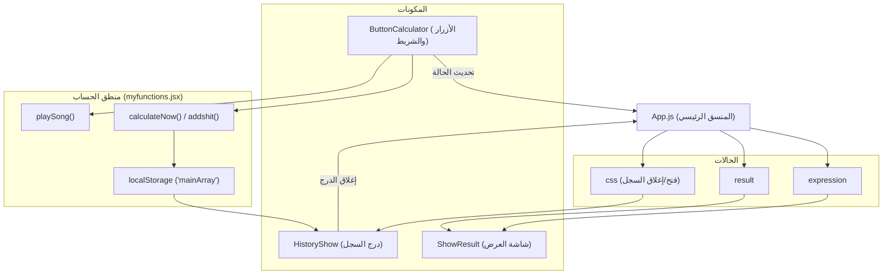
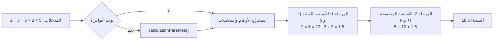
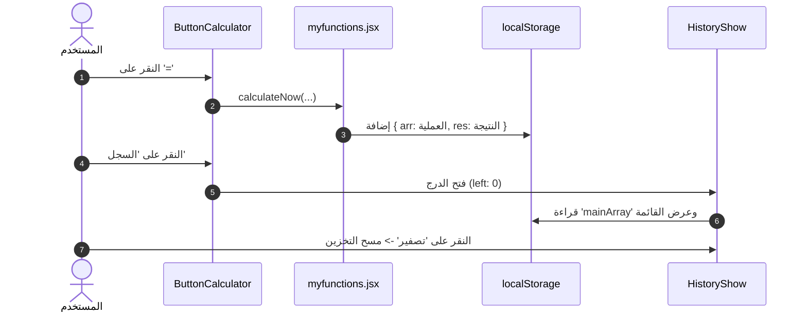

<div align="center">

# 🧮 آلة حاسبة تفاعلية حديثة

**آلة حاسبة عصرية بواجهة داكنة مبنية بـ React 19، بمحرك حسابي يحترم أسبقية العمليات (BODMAS)، ومؤثرات صوتية، وسجل دائم.**

[](https://react.dev/)
[](https://developer.mozilla.org/en-US/docs/Web/CSS)
[](LICENSE)

[🌐 **English Version (النسخة الإنجليزية)**](./README.md)

</div>

---

## 📱 المخطط البصري للواجهة

```text
┌────────────────────────────────────────────────────────┐
│                   حاوية الآلة الحاسبة                  │
│  ┌──────────────────────────────────────────────────┐  │
│  │ شاشة العرض:   (12 + 8) × 4 ÷ 2 = 40              │  │
│  └──────────────────────────────────────────────────┘  │
│  ┌──────────────────────────────────────────────────┐  │
│  │ شريط الأدوات:             [ 🕒 السجل ] [ 🗑️ ]    │  │
│  └──────────────────────────────────────────────────┘  │
│  ┌──────────────────────────────────────────────────┐  │
│  │ لوحة الأزرار:                                    │  │
│  │   [  C  ]   [  (  ]   [  )  ]   [  ÷  ]          │  │
│  │   [  7  ]   [  8  ]   [  9  ]   [  ×  ]          │  │
│  │   [  4  ]   [  5  ]   [  6  ]   [  -  ]          │  │
│  │   [  1  ]   [  2  ]   [  3  ]   [  +  ]          │  │
│  │   [  D  ]   [  0  ]   [  .  ]   [  =  ]          │  │
│  └──────────────────────────────────────────────────┘  │
│  ┌─────────────────────────┐                           │
│  │ ◄ درج السجل المنزلق     │                           │
│  │ [ 🗑️ تصفير ] [ ✕ إغلاق ] │                           │
│  │ 10 + 5 = 15             │                           │
│  │ 40 ÷ 2 = 20             │                           │
│  └─────────────────────────┘                           │
└────────────────────────────────────────────────────────┘
```

---

## ✨ المميزات الرئيسية

- **تصميم زجاجي داكن**: واجهة عصرية شبه شفافة مع مؤثرات ناعمة باللون البرتقالي (`#FF6500`).
- **محرك رياضي آمن (بدون `eval`)**: خوارزمية مخصصة لحساب الأقواس وأسبقية العمليات (الضرب والقسمة قبل الجمع والطرح).
- **تدقيق المدخلات**: منع المعاملات المزدوجة المتتالية (`++`، `*/`)، الفواصل المتكررة (`..`)، والبدء بمعاملات خاطئة.
- **سجل دائم (LocalStorage)**: درج منزلق يعرض العمليات السابقة مع خيار حذف وتصفير السجل.
- **تأثيرات صوتية**: أصوات تفاعلية مختلفة للنقر، الحذف (`D`)، التصفير (`C`)، وفتح السجل.

---

## 🏗️ معمارية المشروع وتدفق البيانات



---

## ⚙️ خوارزمية الحساب (أسبقية العمليات)



---

## 🔄 دورة حياة السجل (LocalStorage)



---

## 📁 هيكل الملفات

```text
calculator/
├── public/                 # المؤثرات الصوتية MP3 وقالب HTML
├── src/
│   ├── components/
│   │   ├── buttons_calculator.js  # لوحة الأزرار وشريط الأدوات
│   │   ├── history_show.js        # درج السجل المنزلق
│   │   ├── myfunctions.jsx        # المحرك الرياضي والمؤثرات الصوتية
│   │   └── show_result.js         # شاشة العرض الرقمية
│   ├── App.css                    # التنسيقات والتحريكات والسمة الداكنة
│   ├── App.js                     # إدارة الحالة الرئيسية
│   └── index.js                   # نقطة الدخول للتطبيق
├── package.json
├── README.md                      # التوثيق باللغة الإنجليزية
└── README.ar.md                   # التوثيق باللغة العربية
```

---

## 🚀 البدء السريع والتشغيل

```bash
# 1. الاستنساخ وتثبيت الحزم
git clone https://github.com/your-username/calculator.git
cd calculator
npm install

# 2. تشغيل السيرفر المحلي (http://localhost:3000)
npm start

# 3. بناء المشروع للإنتاج
npm run build
```
