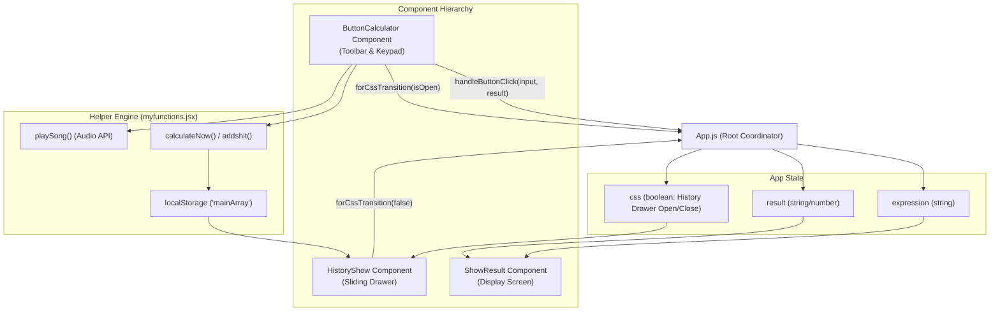
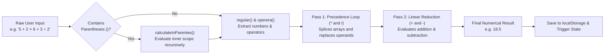
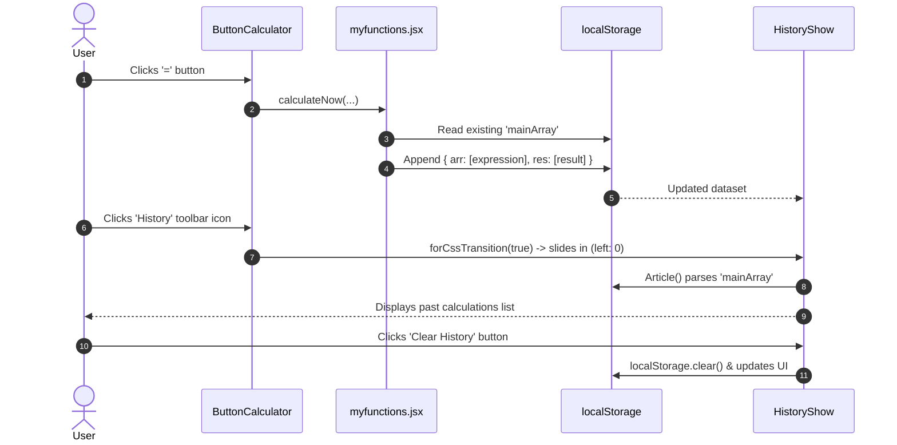

<div align="center">

# 🧮 Modern React Calculator & History Drawer

**A sleek, feature-packed dark-themed calculator built with React 19, custom mathematical precedence parsing, sound effects, and persistent history.**

[](https://react.dev/)
[](https://developer.mozilla.org/en-US/docs/Web/CSS)
[](https://developer.mozilla.org/en-US/docs/Web/JavaScript)
[](LICENSE)

[🌐 **قراءة التوثيق باللغة العربية (Read in Arabic)**](./README.ar.md)

</div>

---

## 📑 Table of Contents

- [Overview](#overview)
- [UI & Layout Schematic](#ui--layout-schematic)
- [Key Features](#key-features)
- [Architecture & Data Flow](#architecture--data-flow)
- [Calculation Algorithm & Operator Precedence](#calculation-algorithm--operator-precedence)
- [History & Local Storage Flow](#history--local-storage-flow)
- [Project File Structure](#project-file-structure)
- [Getting Started & Installation](#getting-started--installation)
- [Available Scripts](#available-scripts)

---

## Overview

This project is a high-performance, responsive **Web Calculator** application developed with **React**. It features a modern dark-mode aesthetic inspired by contemporary mobile operating systems (iOS and Android calculators) and design systems like Vercel and Linear.

Unlike simple calculators relying on JavaScript's unsafe `eval()`, this calculator implements its own **custom mathematical evaluation engine** that enforces operator precedence (BODMAS/PEMDAS: parentheses first, multiplication and division before addition and subtraction), rigorous input validation, real-time auditory feedback for each interaction, and an animated drawer for managing calculation history stored persistently via `localStorage`.

---

## UI & Layout Schematic

```text
┌────────────────────────────────────────────────────────┐
│                   CALCULATOR CONTAINER                 │
│                                                        │
│  ┌──────────────────────────────────────────────────┐  │
│  │                   DISPLAY SCREEN                 │  │
│  │  Expression: (12 + 8) × 4 ÷ 2                    │  │
│  │  Result:     40                                  │  │
│  └──────────────────────────────────────────────────┘  │
│                                                        │
│  ┌──────────────────────────────────────────────────┐  │
│  │                   TOOLBAR                        │  │
│  │                            [ 🕒 History ] [ 🗑️ ] │  │
│  └──────────────────────────────────────────────────┘  │
│                                                        │
│  ┌──────────────────────────────────────────────────┐  │
│  │                   KEYPAD GRID                    │  │
│  │   [  C  ]   [  (  ]   [  )  ]   [  ÷  ]          │  │
│  │   [  7  ]   [  8  ]   [  9  ]   [  ×  ]          │  │
│  │   [  4  ]   [  5  ]   [  6  ]   [  -  ]          │  │
│  │   [  1  ]   [  2  ]   [  3  ]   [  +  ]          │  │
│  │   [  D  ]   [  0  ]   [  .  ]   [  =  ]          │  │
│  └──────────────────────────────────────────────────┘  │
│                                                        │
│  ┌─────────────────────────┐                           │
│  │ ◄ SLIDING HISTORY DRAWER│                           │
│  │ [ 🗑️ Clear ] [ ✕ Close ] │                           │
│  │ ─────────────────────── │                           │
│  │  10 + 5                 │                           │
│  │  = 15                   │                           │
│  │ ─────────────────────── │                           │
│  │  40 ÷ 2                 │                           │
│  │  = 20                   │                           │
│  └─────────────────────────┘                           │
└────────────────────────────────────────────────────────┘
```

---

## Key Features

- 🎨 **Modern Dark Glassmorphic Design**: Clean UI with frosted borders, subtle glow states, and cohesive accent colors (`#FF6500`).
- ⚡ **Zero-Eval Mathematical Parser**: Custom algorithmic parser (`addshit` & `calculateInParentes`) that respects order of operations without executing arbitrary code.
- 🛡️ **Robust Input Guardrails**:
  - Blocks starting with invalid operators (`*`, `/`, `)`).
  - Prevents double operators (e.g. `++`, `*-`) and duplicate decimals (`..`).
  - Validates matching parenthesis and automatically closes trailing brackets.
- 📜 **Persistent Sliding History Panel**:
  - Smooth slide-in/out transition panel for prior equations.
  - Saved persistently using the browser's `localStorage` (`mainArray`).
  - Dedicated history reset and panel close buttons.
- 🔊 **Tactile Audio Feedback**: Distinct audio effects for regular key clicks, digit deletion (`D`), full screen clear (`C`), and history actions.
- 📱 **Mobile & Desktop Responsive**: Fits comfortably on compact mobile viewports as well as widescreen desktops.

---

## Architecture & Data Flow

The application follows a unidirectional data flow coordinated through `App.js`:



---

## Calculation Algorithm & Operator Precedence

Mathematical expressions are evaluated through a two-pass algorithmic pipeline in `myfunctions.jsx`:



### Mathematical Precedence Example
Given input: `5 + 2 * 6 + 3 / 2`
1. **Pass 1 (Multiplication & Division)**:
   - `2 * 6` is evaluated first $\rightarrow 12$. The array becomes `[5, 12, 3, 2]`, operators `[+, +, /]`.
   - `3 / 2` is evaluated next $\rightarrow 1.5$. The array becomes `[5, 12, 1.5]`, operators `[+, +]`.
2. **Pass 2 (Addition & Subtraction)**:
   - `5 + 12 = 17`
   - `17 + 1.5 = 18.5`
3. **Correct result returned**: `18.5` (unlike naive linear calculators that would compute `16`).

---

## History & Local Storage Flow



---

## Project File Structure

```text
calculator/
├── public/
│   ├── clearItemsAll.mp3      # Sound effect for clear (C)
│   ├── clicksong.mp3          # Sound effect for standard buttons
│   ├── deleteOne.mp3          # Sound effect for delete (D)
│   ├── historysound.mp3       # Sound effect for history drawer toggle
│   ├── index.html             # HTML5 template
│   └── robots.txt
├── src/
│   ├── components/
│   │   ├── buttons_calculator.js  # Keypad, toolbar, & button event handlers
│   │   ├── history_show.js        # Sliding history drawer & clear history controls
│   │   ├── myfunctions.jsx        # Mathematical parsing, precedence, & audio logic
│   │   └── show_result.js         # Digital readout display screen
│   ├── App.css                # Global theme, glassmorphism, responsive styles
│   ├── App.js                 # Primary React application component & state hub
│   ├── App.test.js            # Unit and component tests
│   ├── index.css              # Reset and root baseline styles
│   ├── index.js               # Application entry point (ReactDOM)
│   ├── reportWebVitals.js
│   └── setupTests.js
├── package.json               # Dependencies and npm scripts
├── README.md                  # English Documentation
└── README.ar.md               # Arabic Documentation
```

---

## Getting Started & Installation

### Prerequisites
- [Node.js](https://nodejs.org/) (version 16 or newer recommended)
- [npm](https://www.npmjs.com/) or [pnpm](https://pnpm.io/) or [yarn](https://yarnpkg.com/)

### 1. Clone the repository
```bash
git clone https://github.com/your-username/calculator.git
cd calculator
```

### 2. Install dependencies
```bash
npm install
```

### 3. Run development server
```bash
npm start
```
The app will open automatically in your default browser at [http://localhost:3000](http://localhost:3000).

### 4. Build for production
```bash
npm run build
```
Creates an optimized, minified production build inside the `build/` folder.

---

<div align="center">
  <sub>Developed with care & precision 🚀</sub>
</div>
