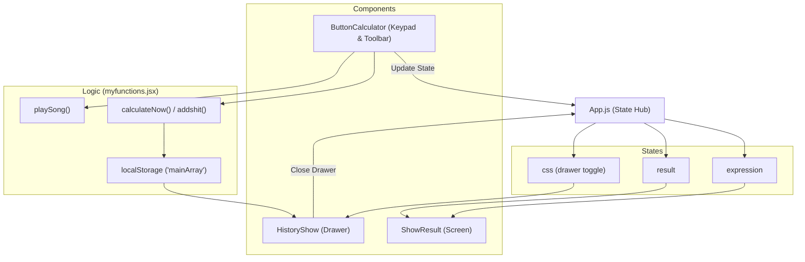
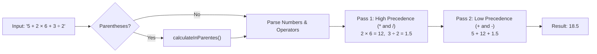
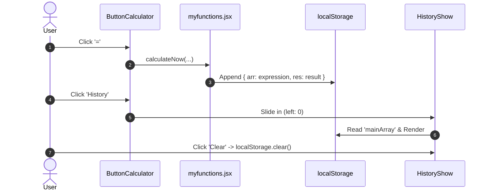

<div align="center">

# 🧮 Modern React Calculator

**A sleek dark-themed calculator built with React 19, custom BODMAS precedence parsing, audio feedback, and persistent history.**

[](https://react.dev/)
[](https://developer.mozilla.org/en-US/docs/Web/CSS)
[](LICENSE)

[🌐 **النسخة العربية (Arabic Version)**](./README.ar.md)

</div>

---

## 📱 UI Layout

```text
┌────────────────────────────────────────────────────────┐
│                   CALCULATOR CONTAINER                 │
│  ┌──────────────────────────────────────────────────┐  │
│  │ DISPLAY SCREEN:  (12 + 8) × 4 ÷ 2 = 40           │  │
│  └──────────────────────────────────────────────────┘  │
│  ┌──────────────────────────────────────────────────┐  │
│  │ TOOLBAR:                 [ 🕒 History ] [ 🗑️ ]   │  │
│  └──────────────────────────────────────────────────┘  │
│  ┌──────────────────────────────────────────────────┐  │
│  │ KEYPAD:                                          │  │
│  │   [  C  ]   [  (  ]   [  )  ]   [  ÷  ]          │  │
│  │   [  7  ]   [  8  ]   [  9  ]   [  ×  ]          │  │
│  │   [  4  ]   [  5  ]   [  6  ]   [  -  ]          │  │
│  │   [  1  ]   [  2  ]   [  3  ]   [  +  ]          │  │
│  │   [  D  ]   [  0  ]   [  .  ]   [  =  ]          │  │
│  └──────────────────────────────────────────────────┘  │
│  ┌─────────────────────────┐                           │
│  │ ◄ SLIDING HISTORY DRAWER│                           │
│  │ [ 🗑️ Clear ] [ ✕ Close ] │                           │
│  │ 10 + 5 = 15             │                           │
│  │ 40 ÷ 2 = 20             │                           │
│  └─────────────────────────┘                           │
└────────────────────────────────────────────────────────┘
```

---

## ✨ Features

- **Dark Glassmorphic UI**: Frosted semi-transparent dark surfaces with `#FF6500` accents.
- **Custom Math Engine (No `eval`)**: Custom parser enforcing parentheses and operator precedence (`×` & `÷` before `+` & `-`).
- **Input Validation**: Prevents invalid leading operators, double symbols (`++`, `*/`), and duplicate decimals (`..`).
- **Persistent History**: Slide-in drawer saving calculations to browser `localStorage`.
- **Audio Feedback**: Distinct sound effects for typing, deleting, clearing, and toggling history.

---

## 🏗️ Architecture & Data Flow



---

## ⚙️ Calculation Algorithm (Order of Operations)



---

## 🔄 History Flow (LocalStorage)



---

## 📁 File Structure

```text
calculator/
├── public/                 # MP3 Audio effects & HTML template
├── src/
│   ├── components/
│   │   ├── buttons_calculator.js  # Keypad & toolbar
│   │   ├── history_show.js        # Sliding history drawer
│   │   ├── myfunctions.jsx        # Math engine & audio logic
│   │   └── show_result.js         # Readout screen
│   ├── App.css                    # Glassmorphism styling & animations
│   ├── App.js                     # Root state management
│   └── index.js                   # App entry point
├── package.json
├── README.md                      # English documentation
└── README.ar.md                   # Arabic documentation
```

---

## 🚀 Quick Start

```bash
# 1. Clone & Install
git clone https://github.com/your-username/calculator.git
cd calculator
npm install

# 2. Start Dev Server (http://localhost:3000)
npm start

# 3. Production Build
npm run build
```
